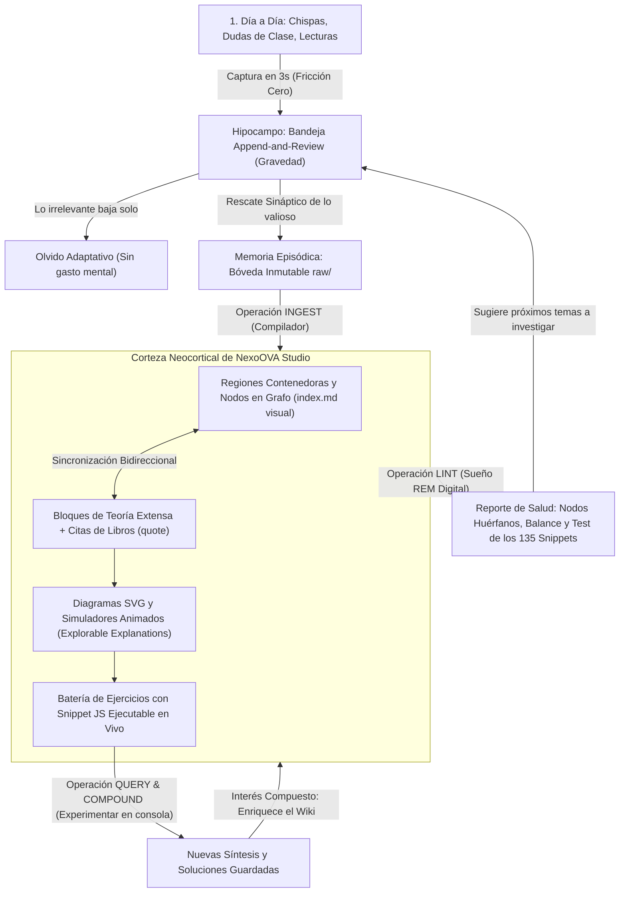

# Propuesta 1: Acercamiento Integral de NexoOVA Studio al "Cerebro Digital" de Andrej Karpathy
### *Análisis y Diseño desde la Triple Perspectiva: Neuroanalista + Pedagogo + Arquitecto de Software*

**Documento:** `propuesta1.md` (Visión Completa / *Full Karpathy Brain Architecture*)  
**Proyecto Base:** **NexoOVA Studio** (Lienzo en Grafo + Constructor In-Situ de OVAs + Laboratorios Animados + Snippets JS Ejecutables + APK Android)

---

## 1. Introducción: La Mirada Tripartita sobre NexoOVA Studio

Para transformar **NexoOVA Studio** en un sistema que gestione y enriquezca el conocimiento diario con la potencia del **"LLM Wiki / Second Brain" de Andrej Karpathy**, debemos alinear tres leyes que operan simultáneamente cuando un ser humano aprende o enseña tecnología:

1. 🧠 **Como Neuroanalista (Leyes de la Memoria Biológica):** El cerebro humano no guarda páginas terminadas desde el primer día. Primero captura trazas rápidas en el **hipocampo** (memoria episódica de corto plazo), luego filtra el ruido por **gravedad/olvido adaptativo**, y finalmente —durante la reflexión y el sueño REM— **consolida y mieliniza** esas trazas dentro de la **neocorteza** (memoria semántica a largo plazo), conectando lo nuevo con esquemas previos y podando contradicciones.
2. 🎓 **Como Pedagogo (Leyes del Aprendizaje Significativo y Constructivismo):** Un Objeto Virtual de Aprendizaje (OVA) no debe ser un documento muerto que se escribe una vez y queda congelado. Debe ser un **organismo pedagógico en evolución continua**: las dudas que surgen hoy en clase, un nuevo libro leído por el instructor o un ejercicio resuelto de forma creativa por un aprendiz deben poder **retroalimentar y enriquecer la OVA con interés compuesto**.
3. 💻 **Como Programador de Software (Leyes de Compilación, Estado Local-First y Grafos):** En lugar de tratar los apuntes del día y las OVAs como cosas separadas, debemos implementar en TypeScript el ciclo de compilación de Karpathy (**`inbox (gravedad)` → `raw/ (fuentes inmutables)` → `INGEST (compilador a bloques)` → `wiki/ (Canvas + OVAs)` → `LINT (auditor de salud)`**).

---

## 2. Diagnóstico Neuro-Pedagógico: ¿Qué Tiene Hoy NexoOVA Studio y Qué le Falta frente al Cerebro de Karpathy?

Si mapeamos la arquitectura actual de **NexoOVA Studio** contra la anatomía de un cerebro biológico y contra el patrón de Karpathy, encontramos lo siguiente:

```
┌───────────────────────────────────────────────────────────────────────────────────┐
│        ANATOMÍA COMPARADA: CEREBRO BIOLÓGICO vs. KARPATHY vs. NEXO-OVA            │
├─────────────────────────┬──────────────────────────┬──────────────────────────────┤
│ Estructura Biológica    │ Patrón de Karpathy       │ Estado Actual en NexoOVA     │
├─────────────────────────┼──────────────────────────┼──────────────────────────────┤
│ 1. Memoria Sensorial y  │ Nota "Append-and-Review" │ ❌ FALTA: Hoy para anotar    │
│    Hipocampo (Captura   │ (Añadir arriba en 3 seg  │ algo debes crear ya un nodo  │
│    rápida sin filtro)   │ y dejar bajar por peso)  │ formal o abrir una lección.  │
├─────────────────────────┼──────────────────────────┼──────────────────────────────┤
│ 2. Memoria Episódica    │ Carpeta raw/ Inmutable   │ ❌ FALTA: No hay bóveda para │
│    (Recuerdos crudos    │ (Artículos, PDFs, notas  │ guardar apuntes crudos del   │
│    tal como ocurrieron) │ de clase sin alterar)    │ día antes de ser lección.    │
├─────────────────────────┼──────────────────────────┼──────────────────────────────┤
│ 3. Corteza Asociativa y │ index.md + Páginas wiki/ │ ✅ EXCELENTE: El Lienzo en   │
│    Espacial (Mapa de    │ interconectadas con      │ Grafo (Regiones + Nodos +    │
│    conceptos en red)    │ enlaces [[concepto]]     │ Aristas) es un index visual. │
├─────────────────────────┼──────────────────────────┼──────────────────────────────┤
│ 4. Corteza Motora y     │ (Karpathy solo usa texto │ 🏆 NEXO-OVA SUPERA A         │
│    Prefrontal (Acción   │ Markdown estático en su  │ KARPATHY: Tiene Simuladores  │
│    práctica y prueba)   │ wiki)                    │ Animados + 135 Snippets JS   │
│                         │                          │ Ejecutables en Vivo (< 1ms). │
├─────────────────────────┼──────────────────────────┼──────────────────────────────┤
│ 5. Sueño REM y Poda     │ Operación LINT (Auditar  │ ❌ FALTA: No hay un motor    │
│    Sináptica (Detectar  │ contradicciones, vacíos  │ que audite qué nodos están   │
│    errores y vacíos)    │ y páginas huérfanas)     │ huérfanos o incompletos.     │
├─────────────────────────┼──────────────────────────┼──────────────────────────────┤
│ 6. Plasticidad por Uso  │ QUERY & COMPOUND         │ ⚠️ PARCIAL: El aprendiz      │
│    (Cada pregunta hace  │ (Guardar las respuestas  │ ejecuta código, pero sus     │
│    más sabio al sistema)│ de vuelta en el wiki)    │ hallazgos aún no enriquecen  │
│                         │                          │ el grafo ni su cuaderno.     │
└─────────────────────────┴──────────────────────────┴──────────────────────────────┘
```

### Conclusión del Diagnóstico:
**NexoOVA Studio ya tiene la "Corteza Superior" más avanzada** (el Lienzo en Grafo, el Editor In-Situ por bloques tipados y los Snippets de Código Ejecutables), pero **le falta el "Sistema Límbico / Hipocampo" de entrada diaria y mantenimiento autónomo** que hace que el sistema de Karpathy sea tan adictivo para capturar lo que se aprende día a día.

---

## 3. Arquitectura de la Propuesta 1: Los 5 Subsistemas para Acercar NexoOVA Studio al 100% del Cerebro de Karpathy

A continuación se diseña cómo incorporar cada mecanismo de Karpathy dentro de **NexoOVA Studio**, explicando su justificación neuro-pedagógica y su implementación exacta en software.

---

### Subsistema 1: El Hipocampo Digital — Flujo "Append-and-Review" con Gravedad Temporal

* 🧠 **Fundamento Neuroanalítico:** Cuando estás estudiando un libro, programando o dictando clase y surge una idea brillante, tu **memoria de trabajo** (*Working Memory*, limitada a ~4 bloques según Nelson Cowan) se satura si el software te obliga a elegir en qué OVA, en qué lección y en qué tipo de bloque guardarla. Esa fricción rompe el **estado de flujo (*Flow*)**.
* 🎓 **Fundamento Pedagógico:** El docente y el aprendiz necesitan un **capturador universal de chispas cognitivas** donde puedan anotar en 3 segundos un comando, una cita de un libro, un error común visto en clase o una pregunta por investigar.
* 💻 **Implementación en NexoOVA Studio (`GravityInboxDrawer.tsx`):**
  1. Un botón flotante permanente (o atajo `Alt + N`) abre la **Bandeja con Gravedad (*Append-and-Review*)**.
  2. Solo tiene un campo de entrada en la parte superior. Todo lo que escribes se inserta en el **índice `0` (arriba del todo)** con fecha automática y detección inteligente de prefijos:
     * `idea:` → Semilla conceptual
     * `libro:` o `cita:` → Referencia bibliográfica futura
     * `codigo:` → Snippet o truco técnico
     * `ejercicio:` → Idea para un reto práctico
     * `duda:` → Laguna de conocimiento por investigar
  3. **Algoritmo de Gravedad Visual:** A medida que entran notas nuevas arriba y pasan los días, las notas inferiores reducen suavemente su opacidad (`100%` → `75%` → `50%`).
  4. **Dos acciones de rescate sináptico en cada nota:**
     * **`↑ Subir a la Superficie (Re-potenciar)`:** La devuelve al tope (`index 0`) reiniciando su gravedad porque sigue siendo importante.
     * **`⚡ Enviar a Bóveda Cruda (raw/) o Compilar al Canvas`:** La promueve directamente al flujo de compilación de OVAs.

---

### Subsistema 2: La Memoria Episódica Inmutable — La Bóveda `raw/` por Contenedor/OVA

* 🧠 **Fundamento Neuroanalítico:** El cerebro distingue entre *"el recuerdo del episodio donde aprendí algo"* (ej. el artículo o capítulo original) y *"el concepto abstracto destilado"*. Nunca debemos destruir la fuente original al resumirla, porque años después necesitamos volver a la fuente para verificar matices.
* 🎓 **Fundamento Pedagógico:** Todo Objeto Virtual de Aprendizaje riguroso debe conservar su **bibliografía y fuentes primarias inmutables** (extractos de la especificación ECMA-262, capítulos de *Eloquent JavaScript*, apuntes crudos del instructor, transcripciones).
* 💻 **Implementación en NexoOVA Studio (`RawVaultPanel`):**
  1. Cada Región Contenedora del Canvas (`GraphRegion` / `OVA`) incorpora una colección inmutable `rawSources: RawSourceEntry[]`.
  2. En esta bóveda `raw/`, el autor suelta textos crudos en Markdown, fragmentos de código sin pulir, enlaces comentados o transcripciones.
  3. **Regla de Inmutabilidad (Karpathy Rule #1):** Una vez guardada una entrada en `rawSources`, queda sellada con marca de tiempo (`createdAt`) y hash/ID (`raw-js-01`). Ningún proceso de edición de la OVA modifica el texto original de `raw/`; en cambio, los bloques de la OVA guardan un puntero `sourceRawId: 'raw-js-01'` que permite hacer clic en *"Ver fuente original cruda"* desde cualquier párrafo o cita de la lección.

---

### Subsistema 3: Consolidación Sináptica — El Compilador `INGEST` (De `raw/` a Nodos y Bloques Polimórficos)

* 🧠 **Fundamento Neuroanalítico:** Es el equivalente a la transferencia nocturna del hipocampo a la neocorteza. Toma una experiencia cruda lineal y la descompone en **nodos semánticos conectados** y **procedimientos motores ejecutables**.
* 🎓 **Fundamento Pedagógico:** Transforma un apunte bruto del profesor en una secuencia didáctica completa bajo el modelo que ya probamos en las 3 OVAs de JavaScript: **Teoría Extensa + Cita de Libro (`quote`) + Esquema Visual (`diagram` / `interactive`) + Ejemplo (`code`) + 5 Ejercicios Cortos (`corto`) + 10 Ejercicios de Desarrollo (`desarrollo`)**.
* 💻 **Implementación en NexoOVA Studio (`KnowledgeCompilerService.ts`):**
  * Cuando el usuario selecciona una entrada de `raw/` y pulsa **`🧠 Ejecutar INGEST (Compilar Conocimiento)`**, el compilador de NexoOVA realiza dos modos de operación:
    1. **Modo Compilador Determinista Local (100% Offline por Reglas de Parsing Markdown):**
       * Analiza la nota cruda:
         * Convierte los encabezados `# / ##` en bloques `heading`.
         * Convierte los párrafos explicativos en bloques `text`.
         * Detecta citas `> "Texto" — Autor, Libro` y las transforma automáticamente en tarjetas bibliográficas `quote` con `quoteAuthor` y `title`.
         * Detecta bloques de código ```` ```javascript ````: si tienen la etiqueta `[ejemplo]` los convierte en bloques `code`; si tienen `[corto]` o `[desarrollo]` los convierte automáticamente en tarjetas interactivas `exercise` con su **Snippet Ejecutable en Vivo** (`exerciseStarterCode` y `exerciseSolution`).
    2. **Modo Compilador Asistido por Agente LLM (Cuando hay conexión o desde el IDE con Antigravity):**
       * Siguiendo el protocolo `AGENTS.md` de Karpathy, el agente lee la fuente de `raw/`, consulta el grafo actual (`INITIAL_REGIONS` e `INITIAL_NODES`), **enriquece los nodos existentes sin duplicarlos**, genera los ejercicios ejecutables y registra el cambio en `log.md`.

---

### Subsistema 4: Red Asociativa y Plasticidad — `index.md` Vivo, Enlaces `[[WikiLinks]]` y `QUERY & COMPOUND`

* 🧠 **Fundamento Neuroanalítico:** Una neurona aislada no almacena conocimiento; **el conocimiento reside en la fuerza de las sinapsis (conexiones) entre neuronas** (*Ley de Hebb: "Neurons that fire together, wire together"*). Además, cada vez que evocamos un recuerdo para resolver un problema nuevo, lo reconsolidamos más fuerte (*Reconsolidation*).
* 🎓 **Fundamento Pedagógico:**
  1. Los conceptos de la **OVA 3 (Arreglos y Objetos)** no están aislados de la **OVA 1 (Tipos Primitivos vs. Heap)** ni de la **OVA 2 (Ciclos `for...of`)**. Deben estar tejidos con enlaces conceptuales visibles.
  2. Cuando un aprendiz o el instructor experimenta en un **Snippet Ejecutable** y crea una variación nueva o una nota sintética, debe poder **guardar ese hallazgo de vuelta en el cerebro (*Compounding*)**.
* 💻 **Implementación en NexoOVA Studio:**
  1. **Sintaxis `[[Concepto]]` con Hover Preview y Backlinks Automáticos:**
     * En cualquier bloque de texto, cita o enunciado de ejercicio, escribir `[[Zona Muerta Temporal]]` o `[[node-js-102]]` crea una píldora interactiva.
     * Al pasar el cursor (*hover*) o tocarla en Android, muestra una tarjeta flotante con el resumen de ese nodo del Canvas y un botón para saltar a él.
     * Al final de cada nodo/lección, se calcula dinámicamente la lista **"🔗 Conectado desde (Backlinks)"**, mostrando qué otras lecciones o ejercicios dependen de ese concepto.
  2. **Catálogo Maestro `index.md` Autogenerado y Buscador Semántico Instantáneo:**
     * Una vista **"🗺️ Índice Sináptico Maestro (`index.md`)"** que lista en formato ultra-compacto todas las Regiones (OVAs), todos los Nodos, todas las Citas de Libros (`quote`) y los 135 Ejercicios Ejecutables, permitiendo filtrar en `< 5 ms` cualquier pieza del cerebro.
  3. **Botón `✨ Guardar Hallazgo en el Cerebro (Compound)` dentro de los Snippets Ejecutables:**
     * Cuando el usuario modifica el código dentro del editor en vivo de un ejercicio, lo ejecuta en consola y descubre un patrón interesante, puede pulsar **`+ Guardar como Síntesis / Variación`**. Esa variación se anexa al nodo como conocimiento acumulado y se registra en la bitácora `log`.

---

### Subsistema 5: El Sueño REM Digital — El Motor `LINT` de Auditoría Neuro-Pedagógica y el Diario `log.md`

* 🧠 **Fundamento Neuroanalítico:** Durante el sueño, el cerebro realiza mantenimiento homeostático: detecta memorias inconexas, resuelve disonancias cognitivas y poda conexiones débiles.
* 🎓 **Fundamento Pedagógico:** Un autor de OVAs que administra decenas de temas y cientos de ejercicios necesita un **co-piloto de calidad curricular** que le indique dónde hay vacíos didácticos antes de que los aprendices los sufran.
* 💻 **Implementación en NexoOVA Studio (`BrainHealthLinter.ts`):**
  * Un panel **"🩺 Auditoría del Cerebro (`LINT` + `log.md`)"** en el Canvas y en el Constructor OVA que ejecuta 6 reglas de diagnóstico automático en tiempo real:
    1. **Nodos Huérfanos (*Orphan Nodes*):** Nodos en el Canvas que no tienen aristas de entrada ni de salida (`edges.length === 0`) o que no están asociados a ninguna Región Contenedora (`!regionId`).
    2. **Desequilibrio Teoría/Práctica (*Cognitive Imbalance*):** Lecciones que tienen bloques de texto pero carecen de la proporción óptima (mínimo 1 cita bibliográfica `quote`, 1 esquema visual `diagram`/`interactive`, 5 ejercicios cortos y 10 de desarrollo).
    3. **Snippets No Verificados:** Ejercicios cuyo `exerciseSolution` o `exerciseStarterCode` lanza un error de sintaxis al pasarlo por `executeLiveJavaScriptSnippet()`. ¡El linter ejecuta en segundo plano los 135 snippets en menos de 40 milisegundos y verifica que todas las soluciones oficiales compilen sin errores!
    4. **Enlaces Rotos (`[[...]]`):** Referencias a nodos o URLs que no existen.
    5. **Sugerencias de Expansión (*Next Research Prompts*):** Propone qué nodos en estado `to_research` o `draft` deberían compilarse a continuación.

---

## 4. Diagrama de Flujo Completo de la Propuesta 1 en NexoOVA Studio



---

## 5. Modelo de Datos en TypeScript para la Propuesta 1 (`src/types/ova.ts`)

Para soportar esta arquitectura completa en NexoOVA Studio, el modelo de tipos se extiende con cuatro estructuras limpias:

```typescript
// 1. Nota rápida con gravedad (Método Append-and-Review de Karpathy)
export interface GravityInboxItem {
  id: string;
  tag: 'idea' | 'libro' | 'codigo' | 'ejercicio' | 'duda';
  content: string;
  createdAt: string;
  lastBoostedAt: string; // Al "rescatarla", sube de nuevo al tope
  promotedToRawId?: string;
}

// 2. Fuente cruda inmutable (Carpeta raw/ de Karpathy)
export interface RawSourceItem {
  id: string;
  title: string;
  sourceType: 'book_excerpt' | 'article' | 'class_notes' | 'code_experiment';
  authorOrOrigin: string;
  rawMarkdown: string; // INMUTABLE: jamás se sobrescribe
  createdAt: string;
  linkedRegionId?: string;
  compiledNodeIds: string[]; // Trazabilidad hacia los nodos generados en wiki/
}

// 3. Bitácora cronológica del cerebro (Archivo log.md de Karpathy)
export interface BrainLogEntry {
  id: string;
  timestamp: string;
  operation: 'INGEST' | 'COMPOUND' | 'LINT' | 'PROMOTE';
  summary: string;
  targetIds: string[];
}

// 4. Reporte del Auditor Neuro-Pedagógico (Operación LINT de Karpathy)
export interface BrainLintIssue {
  id: string;
  severity: 'warning' | 'suggestion' | 'healthy';
  category: 'orphan_node' | 'missing_quotes' | 'missing_exercises' | 'broken_snippet';
  targetTitle: string;
  message: string;
  quickFixAction: string;
}
```

---

## 6. Evaluación Honesta de la Propuesta 1 (Cuándo Elegirla y Cuáles son sus Retos)

### Ventajas de la Propuesta 1:
* **Fidelidad del 100% al paradigma de Karpathy**, superándolo además en el terreno educativo gracias a los **simuladores animados** y a los **snippets de código ejecutables en vivo**.
* Convierte a **NexoOVA Studio** en una plataforma única de **Investigación + Autoría + Ejecución** donde todo lo que el docente estudia en el año se transforma sistemáticamente en material formativo de altísima calidad.
* El **Linter automático de snippets** garantiza matemáticamente que ninguno de los 135+ ejercicios publicados tenga errores de ejecución.

### Retos y Complejidad de la Propuesta 1 (Por qué también vale la pena analizar un Punto Medio):
* Introduce **nuevas capas conceptuales en la interfaz** (Bandeja con Gravedad + Bóveda `raw/` separada + Compilador `INGEST` + Vista `index.md` + Panel `LINT` + Bitácora `log.md`).
* Para un docente que en ciertos días solo quiere abrir el lienzo, anotar una idea rápida y enriquecer una lección en 2 minutos, gestionar 5 subsistemas separados puede generar una curva de aprendizaje adicional.

👉 **Por esta razón exacta, en `propuesta2.md` diseñamos el "Punto Medio" (*Karpathy Lite*):** cómo lograr el **85% de la potencia neuro-pedagógica del cerebro de Karpathy** reduciendo la interfaz y los pasos a la mitad.
